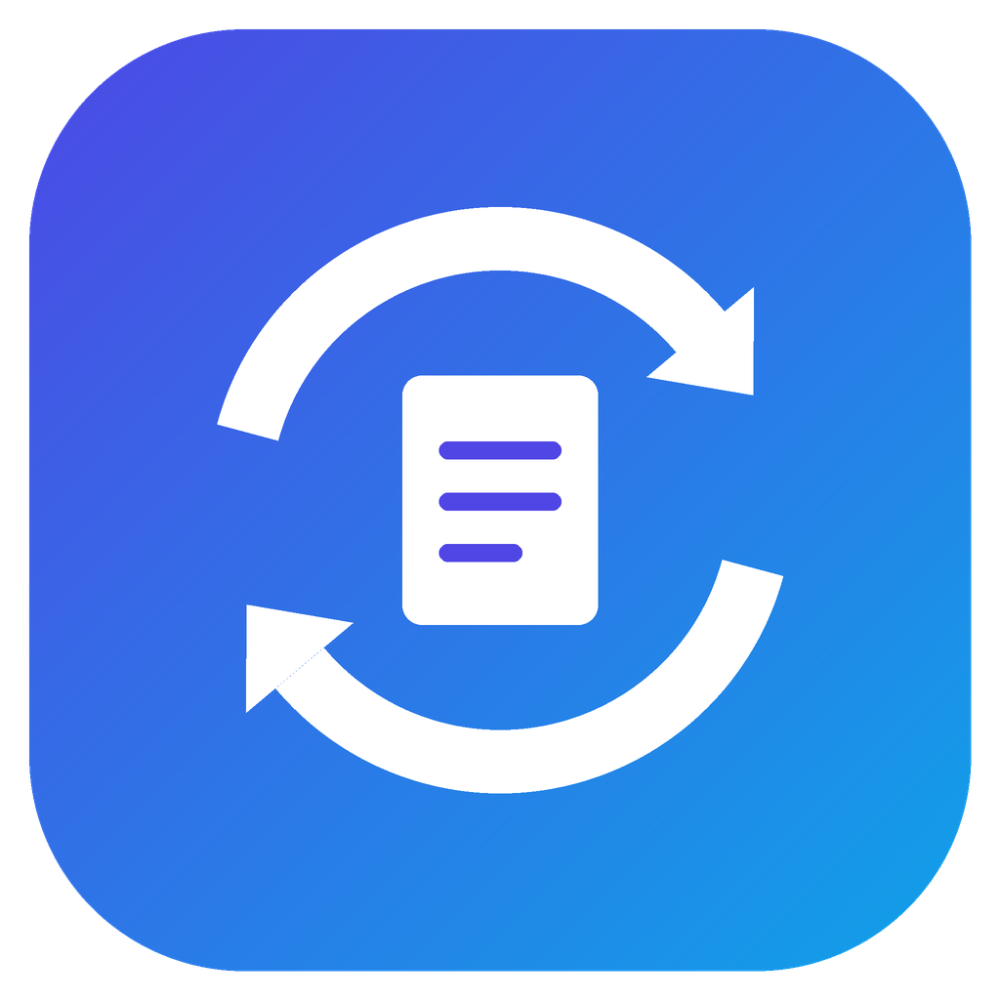
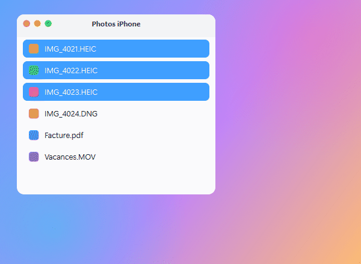
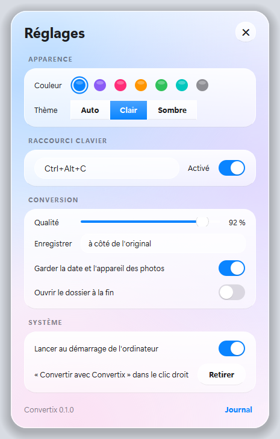

<div align="center">



# Convertix

<a href="https://github.com/VibrAche/convertix/releases/latest">
  
</a>

**Sélectionne un fichier → <kbd>Ctrl</kbd> + <kbd>Alt</kbd> + <kbd>C</kbd> → choisis une bulle. C'est converti.**

[](https://github.com/VibrAche/convertix/releases/latest)
[](https://github.com/VibrAche/convertix/releases)


[](https://github.com/VibrAche/convertix/actions/workflows/build.yml)

<picture>
  <source media="(prefers-color-scheme: dark)" srcset="docs/demo-dark.gif">
  
</picture>

### [⬇️ Télécharger Convertix](https://github.com/VibrAche/convertix/releases/latest)

</div>

---

## ✨ Comment ça marche


- **L'original n'est jamais modifié.** Si `photo.jpg` existe déjà, tu obtiens `photo (1).jpg`.
- **Tout se passe sur ton ordinateur.** Aucun fichier n'est envoyé sur Internet.
- **Autant de fichiers que tu veux** : sélectionne-en 50, ou fais clic droit sur un dossier.
- Les bulles sont en **verre liquide** : elles reflètent ce qu'il y a derrière, comme sur iPhone.

## 🔄 Ce que ça convertit

| Tu as… | Tu obtiens… |
|---|---|
| 📸 Photos iPhone **HEIC**, **DNG / ProRAW**, RAW d'appareils photo | JPG, PNG, WebP, HEIC, AVIF, TIFF, BMP, GIF, ICO, PDF |
| 🖼️ JPG, PNG, WebP, GIF, TIFF, **SVG**… | les mêmes formats (SVG → PDF reste vectoriel) |
| 📄 **PDF** | Word, images (une par page), SVG, texte |
| 🗂️ Plusieurs images ou PDF | **un seul PDF** (bulle « 1 PDF ») |
| 📝 Word, Excel, PowerPoint, OpenDocument | PDF et les autres formats bureautiques \* |
| 📊 CSV ↔ Excel | XLSX, CSV |
| 📚 Livres **EPUB**, MOBI, FB2, XPS | PDF, texte, images |
| 🎬 Vidéos **MOV iPhone**, MP4, MKV, AVI… | MP4, MOV, MKV, WebM, **GIF animé**, ou juste le son |
| 🎵 Audio | MP3, M4A, WAV, FLAC, OGG, Opus |

\* nécessite Microsoft Office **ou** [LibreOffice](https://fr.libreoffice.org/) (gratuit). Sans eux, ces bulles n'apparaissent pas.

## 💾 Installation

<table>
<tr>
<th width="50%">🪟 Windows 10 / 11</th>
<th width="50%">🍎 macOS</th>
</tr>
<tr valign="top">
<td>

1. Télécharge **`Convertix-Setup-x.y.z.exe`** dans les [Releases](https://github.com/VibrAche/convertix/releases/latest).
2. Lance-le. Si Windows affiche « Windows a protégé votre ordinateur » :
   **Informations complémentaires → Exécuter quand même**.
3. C'est prêt : l'icône apparaît près de l'heure et Convertix est dans le clic droit.

Pas besoin de droits administrateur.
Une version **portable** (`.zip`) existe aussi.

</td>
<td>

1. Télécharge le `.dmg` qui correspond à ton Mac :
   - **`mac-apple-silicon`** pour les Mac M1, M2, M3, M4…
   - **`mac-intel`** pour les Mac plus anciens

   Pour savoir lequel tu as :  → À propos de ce Mac.
2. Ouvre le `.dmg` et glisse **Convertix** dans **Applications**.
3. Au premier lancement, macOS bloque l'app (elle n'est pas signée par Apple) :
   **Réglages Système → Confidentialité et sécurité → Ouvrir quand même**.
4. Autorise Convertix dans **Accessibilité** (pour le raccourci <kbd>⌃</kbd><kbd>⌥</kbd><kbd>C</kbd>).
   Optionnel : **Enregistrement de l'écran**, pour l'effet de verre qui reflète le fond.

</td>
</tr>
</table>

## 🎛️ Réglages

Clic droit sur l'icône Convertix (près de l'heure sur Windows, en haut de l'écran sur Mac) → **Réglages**.

<div align="center">
<picture>
  <source media="(prefers-color-scheme: dark)" srcset="docs/settings-dark.png">
  
</picture>
</div>

Couleur d'accent, thème clair / sombre, raccourci clavier, qualité des images, dossier de sortie, démarrage automatique… Chaque changement s'applique tout de suite.

## ❓ Questions

<details>
<summary><b>Le clic droit n'affiche pas Convertix sous Windows 11</b></summary>

Windows 11 range les apps dans **Afficher plus d'options** (ou <kbd>Maj</kbd> + clic droit). Tu peux aussi utiliser **Envoyer vers → Convertix**, ou simplement <kbd>Ctrl</kbd> + <kbd>Alt</kbd> + <kbd>C</kbd>.
</details>

<details>
<summary><b>Le raccourci ne fait rien</b></summary>

Une autre app utilise peut-être déjà <kbd>Ctrl</kbd> + <kbd>Alt</kbd> + <kbd>C</kbd> : Convertix te le signale, change-le dans les Réglages. Sur Mac, vérifie l'autorisation **Accessibilité**.
</details>

<details>
<summary><b>Mes photos sont-elles envoyées quelque part ?</b></summary>

Non. Toutes les conversions se font sur ton ordinateur, même sans connexion Internet.
</details>

<details>
<summary><b>Comment désinstaller ?</b></summary>

Windows : Paramètres → Applications → Convertix → Désinstaller. Mac : Réglages → « Retirer » le clic droit, désactive le démarrage auto, puis mets l'app à la corbeille.
</details>

## 🛠️ Pour les développeurs

```bash
git clone https://github.com/VibrAche/convertix.git && cd convertix
python -m venv .venv && .venv\Scripts\activate          # Mac : source .venv/bin/activate
pip install -r requirements.txt -r requirements-dev.txt
python -m pytest -q                                      # tests
python run.py --verbose                                  # lancer l'app
```

Python 3.12 · PySide6 · Pillow · PyMuPDF · ffmpeg. Les installeurs Windows et Mac sont construits automatiquement par GitHub Actions à chaque version (`git tag vX.Y.Z`).
Architecture, règles et feuille de route : [CLAUDE.md](CLAUDE.md).

---

<div align="center">

Créé avec ❤️ par **Enzo** — [@VibrAche](https://github.com/VibrAche)

Si Convertix te fait gagner du temps, laisse une ⭐ !

</div>
